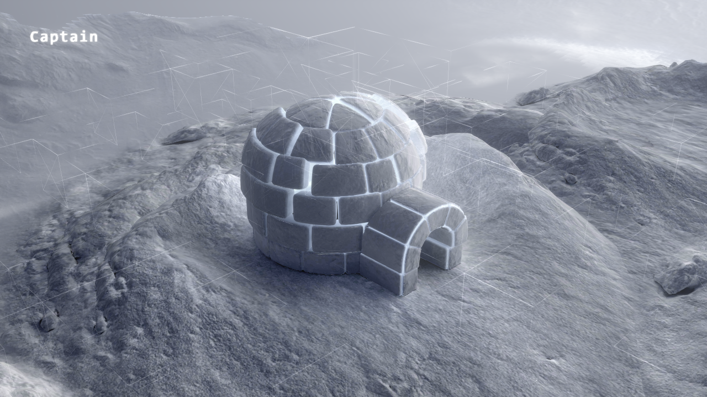
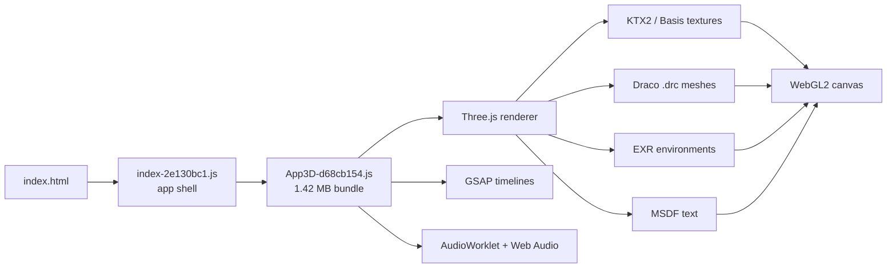

<div align="center">

```
 ██╗ ██████╗ ██╗      ██████╗  ██████╗
 ██║██╔════╝ ██║     ██╔═══██╗██╔═══██╗
 ██║██║  ███╗██║     ██║   ██║██║   ██║
 ██║██║   ██║██║     ██║   ██║██║   ██║
 ██║╚██████╔╝███████╗╚██████╔╝╚██████╔╝
 ╚═╝ ╚═════╝ ╚══════╝ ╚═════╝  ╚═════╝
```

### The frozen igloo, rebuilt to run with zero network calls.

**A local, self-contained mirror of the [igloo.inc](https://www.igloo.inc) WebGL homepage —**
**hashed bundles, Draco meshes, KTX2 textures, EXR environments and all 18 audio tracks,**
**served from a 60-line Node server with no build step.**

[](#-known-limits)
[](https://threejs.org)
[](#-the-stack-observed-in-the-bundle)
[](#-the-stack-observed-in-the-bundle)
[](#-asset-ledger)
[](#-quick-start)
[](https://igloo-inc-recreation.vercel.app)



<sub>Rendered locally in headless Chrome at 1280×720 after an 8-second settle. No CDN, no origin server, no network.</sub>

</div>

---

> [!WARNING]
> **This is a private preservation/study mirror, not an official Igloo Inc. project.**
> All artwork, models, textures, audio, fonts, code and trademarks belong to their
> respective owners. Nothing here is affiliated with, endorsed by, or licensed from
> Igloo Inc. Do not redistribute. See [Legal](#-legal).

---

## ⚡ Quick start

```bash
# from the repo root — no npm install, no build step
npm start
# or: node scripts/serve-recreation.mjs
```

Then open **http://localhost:3000/**.

That's it. The server is a single dependency-free ES module. It sets the MIME types
the GPU and audio pipeline actually need (`image/ktx2`, `application/wasm`,
`audio/ogg`, `image/x-exr`), supports **HTTP Range** requests so the soundtrack can
seek, sends `Cache-Control: no-cache` while you poke at things, and falls back to
`index.html` for non-asset routes.

> **Run it from the repository root.** The server resolves `recreation/` relative to
> the current working directory, and the app requests assets from `/assets/...`.

### ▲ Or use the hosted copy

**<https://igloo-inc-recreation.vercel.app>**

Static, no build step. To redeploy after changes:

```bash
npx vercel deploy recreation --prod --project igloo-inc-recreation --create-if-missing
```

`recreation/vercel.json` adds the SPA fallback and marks hashed `/assets/*` as
immutable. The deployment is unlisted but **publicly reachable** — see [Legal](#-legal).

---

## 🧊 What this is

The original site is a Vite-built, single-bundle WebGL experience: a snowbound igloo,
a scroll-driven camera, shader-driven terrain, a project gallery, and a full soundscape.
This repo freezes that experience into plain static files:

| | Original | This mirror |
|---|---|---|
| HTML shell | points at `https://www.igloo.inc/assets/...` | points at `/assets/...` |
| Asset graph | fetched from the live origin | downloaded, hash names preserved |
| Title | `Igloo Inc.` | `Captain` |
| Runtime | Vite + module preload | one `<script type="module">` |
| Server | production CDN | 60-line Node static server |
| Network | origin + CDN | **loopback only** |

The result is a byte-preserving snapshot you can boot on a plane, in a locked-down
network, or ten years from now when the original bundle is gone.

---

## 📦 Asset ledger

| Bucket | Files | Size | Notes |
|---|---:|---:|---|
| KTX2 textures | 46 | 10.77 MB | Basis Universal supercompressed, GPU-native |
| Draco geometry | 20 | 0.53 MB | `.drc` meshes, decoded in WASM |
| Audio | 18 | 2.80 MB | OGG — music, wind, UI ticks, project stingers |
| JavaScript | 9 | 2.44 MB | `App3D` (1.42 MB) + shell + workers + 3 libs |
| WASM decoders | 2 | 0.72 MB | `basis_transcoder.wasm`, `draco_decoder.wasm` |
| PNG / JPG | 7 | 0.53 MB | social card + favicons + UI imagery |
| Fonts | 4 | 0.19 MB | IBM Plex Mono, WOFF + WOFF2 |
| EXR environment | 1 | 0.25 MB | HDR lighting probe |
| HTML + JSON | 2 | 0.02 MB | shell + MSDF font metrics |
| **Total** | **109** | **18.25 MB** | largest single file: `music-highq.ogg` @ 1.46 MB |

The `site_recreation/original_site/` folder keeps the untouched capture (172 files,
18.34 MB) for side-by-side parity work: same asset names, absolute `igloo.inc` URLs.

---

## 🧠 The stack, observed in the bundle

No source maps shipped, so this is read from the minified bundle's own symbols:

| Layer | Evidence in `App3D-d68cb154.js` |
|---|---|
| Renderer | `WebGLRenderer`, 18 `ShaderMaterial`s, 17 `InstancedMesh`es |
| Engine | Three.js (`THREE` namespace, 200+ references) |
| Geometry | `DRACOLoader` + `draco_decoder.wasm` |
| Textures | `KTX2Loader`, `basis_transcoder.wasm`, `EXRLoader` |
| Motion | GSAP timelines (`gsap`, 50+ references) |
| Post FX | `EffectComposer` render pipeline |
| Text | MSDF text worker (`msdfworker-*.js`) |
| Audio | Web Audio + `AudioWorklet` (`audioworker-*.js`) |
| Misc | bitmap worker, meshopt decoder |



---

## 🗂️ Repo map

```text
igloo-inc-recreation/
├── README.md                     ← you are here
├── docs/
│   └── preview.png               ← local render, 1280×720
├── recreation/                   ← the runnable mirror (109 files, 18.25 MB)
│   ├── index.html                ← relative-URL shell
│   └── assets/
│       ├── App3D-d68cb154.js     ← the whole 3D experience
│       ├── index-2e130bc1.js     ← bootstrap
│       ├── audioworker-*.js
│       ├── msdfworker-*.js
│       ├── images/               ← 45 KTX2 + PNG/JPG + EXR
│       ├── geometries/           ← 20 Draco meshes
│       ├── audio/                ← 18 OGG tracks
│       ├── fonts/                ← MSDF atlas (KTX2 + JSON); WOFFs at assets root
│       └── libs/
│           ├── basis/            ← transcoder JS + WASM
│           └── draco/            ← decoder JS + WASM
├── scripts/
│   └── serve-recreation.mjs      ← dependency-free static server
└── site_recreation/
    └── original_site/            ← pristine capture for parity checks
```

<details>
<summary><b>Full asset inventory (click)</b></summary>

**Textures** — `bokeh`, `caustics`, `clouds_noise`, `floor_color`, `frost-datatexture`,
`mosaic`, `numbers-datatexture`, `perlin-datatexture`, `scroll-datatexture`,
`shapes_blurred`, `shattered_ring_ao`, `shattered_ring_color`, `shattered_ring2_ao`,
`shattered_ring2_color`, `wind_noise`, `cube1_normal`, `cube3_normal`,
`igloo_color`, `igloo_exploded_color`, `ground_color`, `ground_sansigloo_color`,
`mountain_color`, `peachesbody_64`, `pudgy_dark_color`, `overpass_logo_dark_color`, …

**Audio** — `music-highq`, `wind`, `room`, `igloo`, `manifesto`, `logo`, `particles`,
`shard`, `beeps`, `beeps2`, `beeps3`, `circles`, `click-project`, `enter-project`,
`leave-project`, `project-text`, `ui-long`, `ui-short`.

</details>

---

## 🛠️ How the mirror was made

1. **Capture the shell.** Fetch `index.html` and keep the exact bundle filenames
   (`index-2e130bc1.js`, `App3D-d68cb154.js`, …) so hashes stay meaningful.
2. **Walk the asset graph.** Pull every URL the bundle asks for — KTX2 textures,
   `.drc` meshes, OGG tracks, WASM decoders, EXR environment, fonts — into
   `assets/` with the original directory shape.
3. **Relink, don't rewrite.** Only the HTML shell is touched: absolute
   `https://www.igloo.inc/...` URLs become root-relative `/assets/...`. The minified
   bundle is left alone.
4. **Serve it correctly.** The GPU pipeline is picky: KTX2 needs `image/ktx2`, Draco
   needs `application/wasm`, audio needs range requests. The server handles all three.
5. **Prove it renders.** Boot headless Chrome at 1280×720, wait 8 seconds for the
   scene to settle, capture `docs/preview.png`.

No transpiling, no bundling, no dependency tree — the artifact *is* the app.

---

## ✅ Fidelity checklist

| Area | Status | Evidence |
|---|---|---|
| HTML shell + asset graph | ✅ local | zero `igloo.inc` references in `recreation/index.html` |
| 3D scene boots | ✅ | headless render in `docs/preview.png` |
| Shaders / terrain / igloo | ✅ | visible in capture; all KTX2 + DRC assets resolve |
| Audio assets present | ✅ | 18 OGG files, worker + worklet shipped |
| Audio playback | ⚠️ | browser autoplay policy requires a user gesture |
| Scroll / project transitions | ⚠️ | handlers ship in the bundle; parity run still pending |
| Vercel deployment | ✅ | all 109 files byte-identical; scene renders on hardware WebGL |
| Backend / analytics | ❌ | intentionally not mirrored |

Where something is marked ⚠️, the code is present but the behavior has not been
independently verified in this repo. No claim is made beyond what was observed.

---

## 🚀 Performance snapshot

| Metric | Value |
|---|---|
| Cold payload | 18.25 MB / 109 requests (localhost) |
| Largest asset | 1.46 MB (`music-highq.ogg`) |
| JS bundle | 1.42 MB minified (`App3D`) |
| Geometry | 0.53 MB Draco-compressed (vs. many MB raw) |
| Textures | KTX2/Basis, transcoded on the GPU |
| Time to first frame | dominated by texture decode; measured informally, not benchmarked |

The original site is a showcase of asset discipline: almost everything heavy is
compressed, and the whole world fits in less than 20 MB.

---

## 🧭 Known limits

- **Static only.** No API, no CMS, no analytics, no server-side anything.
- **Desktop-first.** The original experience targets pointer + WebGL2; mobile parity
  was not evaluated here.
- **No CI.** This is a preservation snapshot, not a maintained product.
- **Public preservation mirror.** The repository is public; the static deployment
  is hosted on Vercel.
- **Hashes are frozen.** Updating the mirror means re-capturing, not patching.

---

## ⚖️ Legal

This repository exists for **private study and preservation**. It contains a capture
of a publicly accessible website, including third-party artwork, 3D models, textures,
audio, fonts and trademarks. Those assets remain the property of Igloo Inc. and their
respective licensors.

- No license is granted for the captured assets.
- Do not redistribute or promote this mirror; the unlisted Vercel URL exists for
  private review only.
- No affiliation with or endorsement by Igloo Inc. is claimed.
- If you are a rights holder and want something removed, open an issue.

The `serve-recreation.mjs` server script is trivial glue code and may be reused freely.

---

<div align="center">

```
        .-"""-.
       /  _   _  \
      |  (o) (o)  |
      |     ^     |
       \  '---'  /
        '-.___.-'
     let it snow, offline
```

**Built by [@CaptainSanskar4U](https://github.com/CaptainSanskar4U)**
· mirrored from [igloo.inc](https://www.igloo.inc)
· no CDNs were harmed in the making of this repo

</div>
